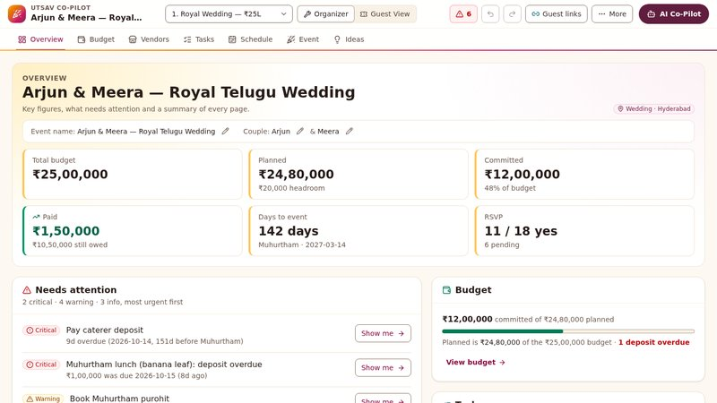

# Utsav: GenAI Event Planning Co-Pilot

A planning assistant for Indian weddings, birthdays and community events. It handles budgets, timelines, vendor checklists and personalised ideas. **Gemini proposes, code computes, you approve.** The LLM never does money or date maths.



**Live:** https://utsav-event-planner-rho.vercel.app · **Technical reference:** [docs/TECHNICAL.md](docs/TECHNICAL.md)

## What it does

| The brief asks for | Utsav | Gemini or code |
|---|---|---|
| Practical setup questions | `/setup`: event, city, dates, guests, budget, your own ₹ or % per category, booked locks, what matters most | Code keeps your amounts exact |
| Budget trade-offs | "Fix by my priorities": cut-first, then flexible; must-protect never cut, each trade-off explained | Code computes, Gemini explains |
| Consequences of decisions | What-if on guest count or a category before committing; per-guest lines rescale | Code |
| Update, don't restart | "Budget dropped ₹50,000 and the event is 2 weeks earlier" becomes one approval card | Gemini `revise_plan`, code applies |
| Timelines and tasks | Sub-event order rules, date cascades, priority order, "Blocked by …" | Code |
| Vendors | Checklist per event type, stages, questions to ask, quote scanner, side-by-side quote comparison | Gemini Vision and drafting, code compares |
| Honest estimates | Every figure tagged Estimate, Quoted, Committed or Unverified; no availability claimed | Code |
| Personalised ideas | Ideas within what's left in the budget; Cheaper, Kid-friendly, More traditional; adopt as a task or budget line | Gemini or offline bank |
| Culture and guests | Ritual-aware templates, diets, shared guest pages with RSVP; private events and money hidden | Config and server rules |

## How it works

- **Gemini 3.5 Flash Lite** with function calling and Vision. The tool schemas are generated from Zod, so the model can only propose valid commands.
- **Deterministic core:** a Zod 4 schema plus a pure reducer (`applyBatch`) in integer paise. Every change is validated, dry-run, shown as a before-and-after diff, and undoable.
- **Trust tiers:** small changes apply automatically, large ones need your approval, and messages are only ever drafts you send yourself.
- **Demo Mode:** the same tools run offline without a key, labelled as offline.
- **Optional Google sign-in:** Firebase Auth plus cloud save of your plans to Firestore through the server (verified tokens, owner-only rules, versioned saves, you choose on a conflict). Keyless: no server secrets, just the four `NEXT_PUBLIC_FIREBASE_*` values ([setup](docs/TECHNICAL.md#optional-google-sign-in-and-cloud-save-firebase)). Without it, plans stay on the device.
- **Stack:** Next.js 16, Tailwind v4, Upstash Redis (shared guest links) and Vercel.

## Quality

- **Security:** Zod at every boundary; guest permissions enforced on the server; hashed organizer tokens; body caps and upload sniffing; redacted logs; rate limiting.
- **Testing:** 648 unit and API tests (Gemini mocked), 124 Playwright end-to-end tests, and a live Gemini smoke test.
- **Accessibility:** WCAG 2.2 AA target, axe on every page in light and dark from 320 to 1280 px, contrast unit-tested, 24 px minimum targets.

## Run it

```
npm install
cp .env.example .env.local
npm run dev
npm run verify
```

Add `GEMINI_API_KEY` to `.env.local` for live Gemini; without it the app runs in Demo Mode. `npm run test:e2e` runs Playwright and `npm run smoke:gemini` checks live Gemini.
