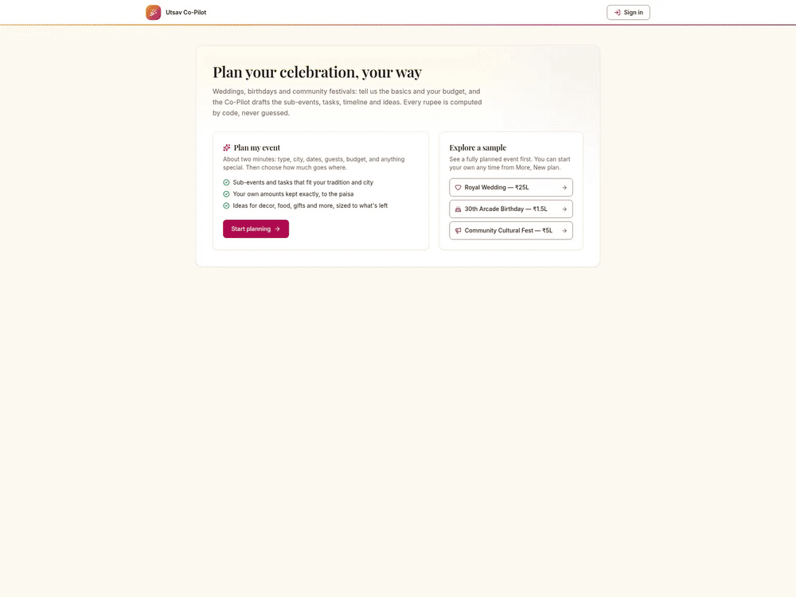

# Utsav: GenAI Event Planning Co-Pilot

Plan Indian weddings, birthdays and community events: budgets, timelines, vendors, guests and ideas in one place.
**Gemini proposes, code computes, you approve.** The model never does money or date maths.

**[Try it live →](https://utsav-event-planner-rho.vercel.app)** No account needed: click *Explore a sample*.



## Why it's different

- **Approval cards, not chat replies.** Say "budget dropped ₹50k and the event is 2 weeks earlier". Gemini proposes a change, code validates and computes it, and you see a before/after diff to approve or undo.
- **Honest numbers.** Every figure is tagged Estimate, Quoted, Committed or Unverified. Trade-offs follow your priorities (must-protect is never cut).
- **Guests at Indian scale.** One RSVP link and QR code for 500+ guests, a form per family, and headcount per function and meal (Veg / Non-veg / Jain), all computed in code.
- **Built for real events.** Ritual-aware templates, a birthday run-sheet, vendor checklists with a quote scanner, a gift registry with surprise mode, and soft delete with Undo.

## How it works

- **Gemini 3.5 Flash Lite** with function calling and Vision. Tool schemas come from Zod, so the model can only propose valid commands.
- **Deterministic core:** a pure reducer in integer paise. Every change is validated, dry-run, diffed and undoable. Trust tiers decide what needs approval.
- **Demo Mode:** works offline without a key, clearly labelled.
- **Optional sign-in:** Firebase Auth plus owner-only cloud save. Keyless: no server secrets.
- **Stack:** Next.js 16 (SSR shell), Tailwind v4, Upstash Redis, Vercel.

## Quality

| | |
|---|---|
| Security | Zod at every boundary, server-enforced guest permissions, rate limits on AI and RSVP routes, no phone numbers in prompts or logs (DPDP) |
| Testing | 1,200+ unit and API tests with a coverage gate (90/85/80), 190+ Playwright end-to-end tests |
| Accessibility | WCAG 2.2 AA target, axe on every page in light and dark mode, contrast unit-tested |

## Run it

```
npm install
cp .env.example .env.local
npm run dev
npm run verify
```

Add `GEMINI_API_KEY` to `.env.local` for live Gemini; without it, the app runs in Demo Mode.
Full details, including the feature list, privacy and Firebase setup, are in [docs/TECHNICAL.md](docs/TECHNICAL.md).
